# Bean Scope-ları və Dependency Injection
## Bölmə 1 · Singleton

### Tapşırıq 7. POST /create ilə user yarat, qaytarılan id ilə GET /{id} çağır. Eyni user gəlirmi? GET /all neçə user qaytarır?
Create metodu ilə user yaratdım, Geri dönən id ilə GetByİd() metodun işə saldım,
həmin user geri döndü. GetAll() bütün userləri gətirdi.2 user əlavə etdim,
toplam 5 user geri döndü.

### Tapşırıq 8. Adi HashMap və long counter burda niyə təhlükəlidir? Singleton bean-i eyni anda neçə thread istifadə edir?

**Thread-safety çatışmazlığı:** Standart HashMap sinfi thread-safe deyil.
Çoxsaylı axınlar (threads) eyni vaxtda daxil olub məlumat yazdıqda və ya oxuduqda daxili strukturu pozula və məlumat itkisi baş verə bilər.
Buna görə ConcurrentHashMap istifadə olunmalıdır.   
**Atomiklik problemi:** Adi Long tipli dəyişən eyni anda iki fərqli thread bu əməliyyatı yerinə yetirərsə, eyni ID dəyəri iki fərqli userə verilə bilər (race condition yaranır).
Buna görə AtomicLong istifadə olunmalıdır.
**Singleton bean-lər** yaddaşda yalnız bir dəfə instansiya olaraq yaradılır.
Onu yalnız bir thread istifadə etmir.
Eyni anda çoxsaylı thread həmin tək Singleton bean-ə müraciət edib istifadə edə bilər.
Məsələn UserRepository Singelton-dur. 

## Bölmə 2 · Prototype

### Tapşırıq 11. Səhv variant: UserAuditLog-u UserInfoService-in konstruktoruna birbaşa inject et. 3 user yarat. Neçə fərqli auditId gördün? Log-u screenshot et.
Program başlayanda 1-ədəd auditId yaratdı.
Nə qədər User əlavə olsada auditId yaranmadı.
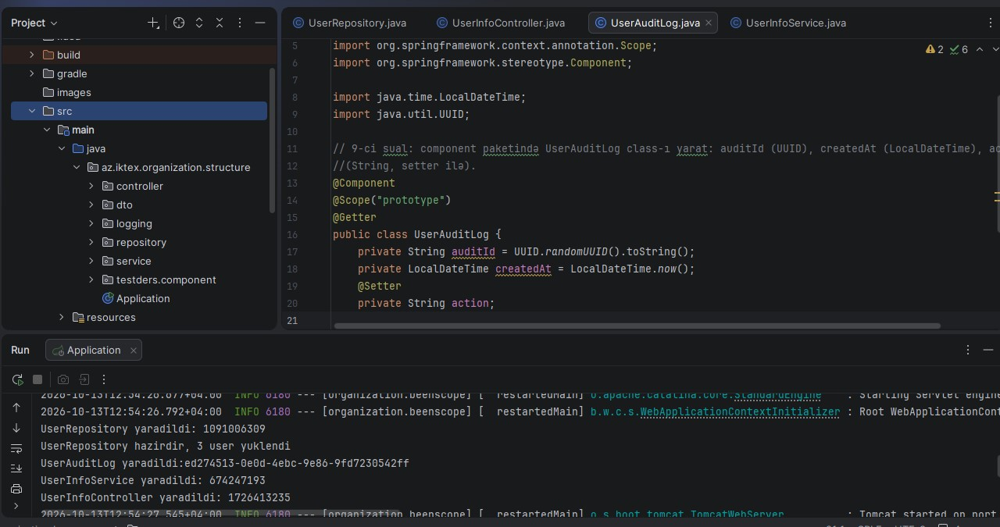

### Tapşırıq 12. Düzgün variant: hər createUser çağırışında yeni obyekt al və action = "CREATE_USER" təyin et. Yenə 3 user yarat.
Hər user yarananda auditId yaranır.
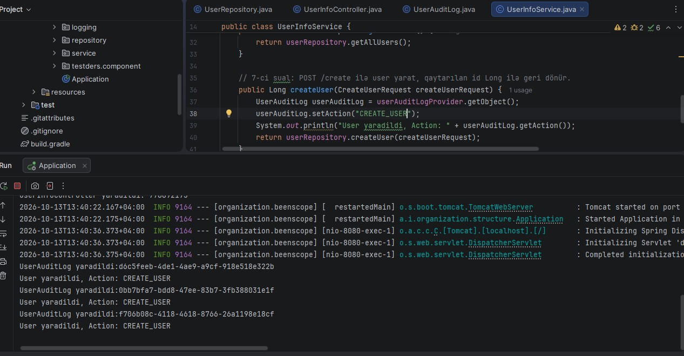

### Tapşırıq 13. UserAuditLog-a @PreDestroy əlavə et və tətbiqi bağla. Log çıxdımı? Niyə? Şərh kimi yaz.
Xeyr, log çıxmadı.Çünki @PreDestroy Singleton bean-lərin lifecycle təmizləyir. Prototype bean-lər üçün @PreDestroy metodunu avtomatik çağırmır.

## Bölmə 3 · Request

### Tapşırıq 16. Hər qatın getUserById metodunda log yaz: [Controller] requestId=..., [Service] ..., [Repository].... Bir sorğuda üçü eyni, növbəti sorğuda fərqli olmalıdır.
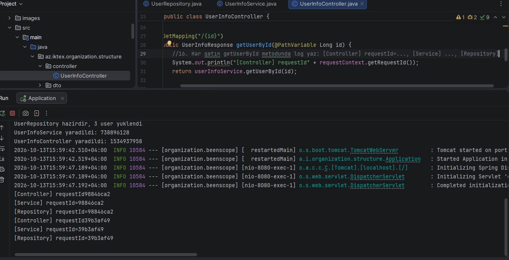

### Tapşırıq 18. @RequestScope-u @Scope("request") ilə əvəz et (proxyMode olmadan). Tətbiq açıldımı? Xətanı şərh kimi yaz, sonra düzəlt. proxyMode = ScopedProxyMode.TARGET_CLASS
Xeyr, tətbiq açılmadı və UnsatisfiedDependencyException xətası verdi.
UserInfoController və digər class-lar qaxan zaman birdəfə yaradılır singleton olur.
RequestContext isə Request-scoped bean-dir və yalnız HTTP sorğu gələndə mövcud olur.
Spring tətbiqi işə salıb Singleton UserInfoController-i və ya digərlərin yaradan anda hələ heç bir HTTP sorğu mövcud deyil.
Bu problemi həll etmək üçün Spring həmin obyektin yerinə Proxy qoymalıdır ki, service yarananda içindəki əsl obyekt yox, Proxy olsun. HTTP sorğu gələndə isə həmin Proxy avtomatik olaraq əsl request-scoped obyektə yönləndirsin.

### Tapşırıq 19. Controller-də requestContext.getClass() çap et. Nə çıxdı? Singleton-a request bean necə inject oluna bilir? İzah et.
Singleton bean-lər tətbiq qalxanda bir dəfə yaranır ömürləri bean bitənə qədər davam edir.
Request bean-lər isə hər sorğu gələndə yaranır, sorğu bitəndə onunda lifecycle-ı bitir.
Lifecycle fərqli olduğu üçün singleton bean içinə Request bean birbaşa əlavə etmək olmur. 
Lakin CGLIB proxy vasitəsilə bu problem həll olunur.
Spring Singleton service içinə RequestContext obyektini deyil onun saxta surətini inject edir.
Service yarananda bu proxy obyekt yerində oturur (buna görə tətbiq xəta vermədən açılır).
Nə vaxt ki, istifadəçi hər hansı bir HTTP sorğu göndərir və həmin proxy-nin hər hansı metoduna müraciət edilir, 
proxy arxa planda dərhal həmin an aktiv olan sorğuya məxsus gerçək RequestContext obyektini tapır və sorğunu ona yönləndirir.
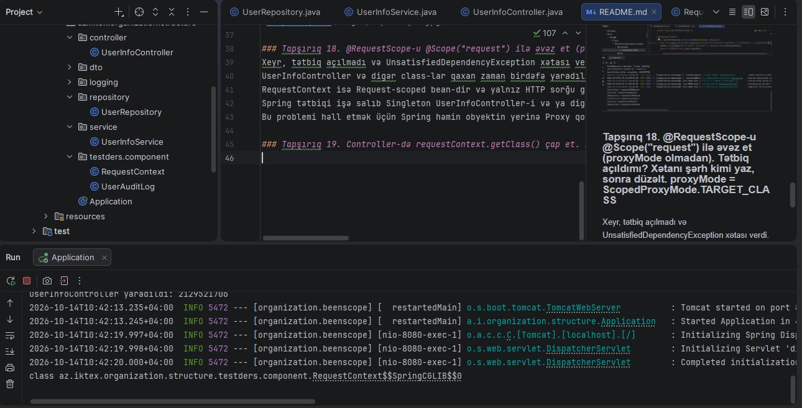

## Bölmə 4 · Session

### Tapşırıq 23. Session müddətini 1 dəqiqəyə endir və @PreDestroy log-unun çıxdığını yoxla.
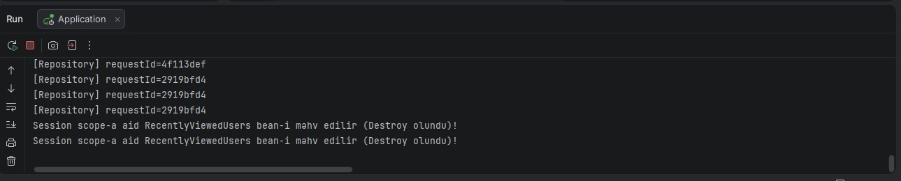

### Tapşırıq 24. Chrome-da /1, /3, /2, /1 aç, sonra /recent. Sonra incognito-da /recent aç. Nəticələri müqayisə et.
Postman-da niyə boş gələ bilər?
Postman müstəqil HTTP müştərisidir və brauzerinizdəki sessiya məlumatlarını (kutiləri) avtomatik olaraq oxuya bilmir.
Postman-da həmin /1, /3, /2 sorğularını göndərib siyahını doldurmadığıma görə, 
birbaşa /recent çağırdıqda server boş sessiyadakı məlumatı oxuyur və nəticə olaraq boş ([]) qaytarır.
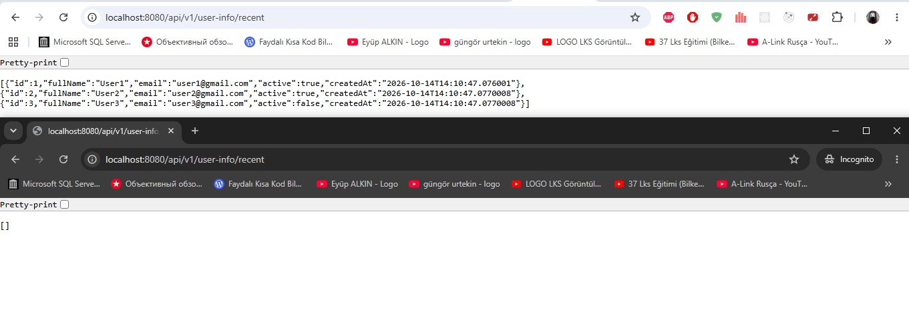
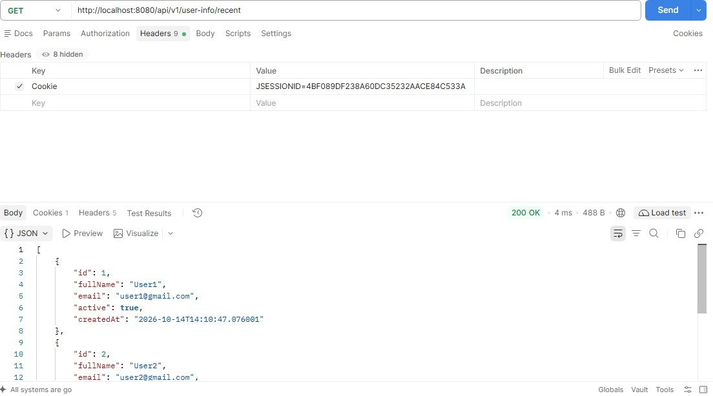

### Tapşırıq 25. Bu siyahını request scope-da saxlasaydıq nə olardı? Şərh kimi yaz.
1. Hər bir HTTP sorğusu (request) üçün tamamilə yeni və boş bir 'RecentlyViewedUsers' obyekti yaranardı.
2. İstifadəçi /1 ünvanına baxanda siyahıya 1 əlavə olunardı, lakin sorğu bitən kimi həmin obyekt məhv olardı.
3. İstifadəçi növbəti dəfə /recent və ya başqa bir user-ə keçəndə əvvəlki sorğunun məlumatları tamamilə itərdi,
çünki request-scoped bean-lər sorğular arasında məlumatı daşımır (hər sorğu bir-biriindən təcrid olunub).
Nəticə: Sessiya boyu ardıcıl olaraq son baxılanları izləmək (history saxlamaq) qeyri-mümkün olardı və /recent endpoint-i həmişə boş siyahı qaytarardı.

## Bölmə 5 · Dependency Injection

### Tapşırıq 27. MockUserRepository yaz — həmişə adı Mock User olan 2 user qaytarsın. Tətbiqi işə sal və xətanı qeyd et.
Spring UserRepository interfeysini tətbiq edən iki fərqli bean aşkar etdi (inMemoryUserRepository və mockUserRepository).
UserInfoService konstruktorunda tək bir UserRepository tələb edərkən Spring çaş-baş qalır ki, onlardan hansını inject etməlidir.
Eyni interfeysi implementasiya edən birdən çox namizəd (bean) olduğu üçün Spring NoUniqueBeanDefinitionException xətası ataraq tətbiqi işə salmağı dayandırır.
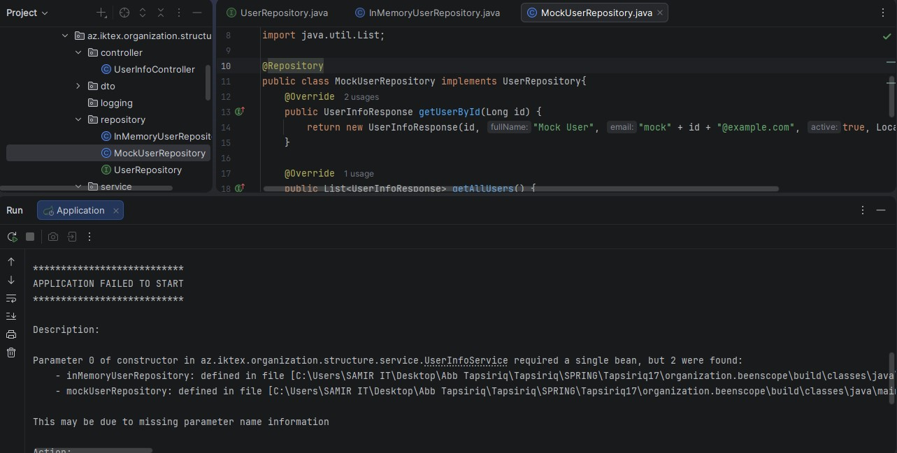

### Tapşırıq 28. Xətanı birinci yolla həll et: InMemoryUserRepository default olsun. @Primary
InMemoryUserRepository class-ını default olaraq gördü və işlədi.
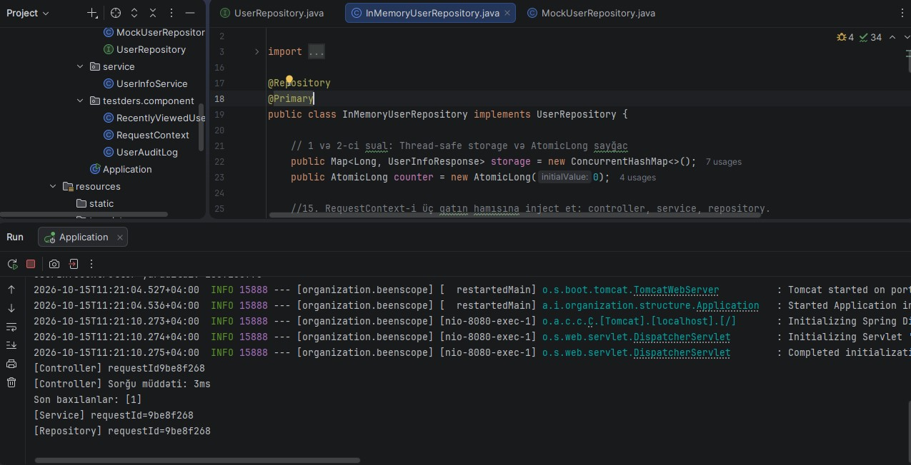

### Tapşırıq 29. @Primary-ni sil, ikinci yolla həll et: service mock repository-ni seçsin. /all indi Mock User qaytarmalıdır. @Qualifier("mockUserRepository")
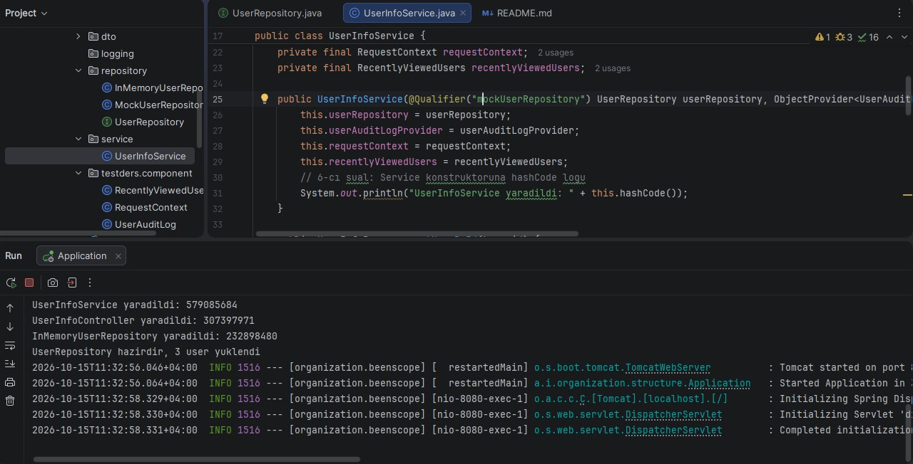
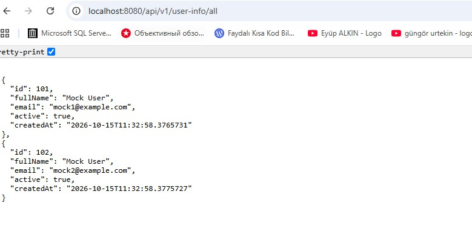

### Tapşırıq 30. NotificationService interface-i yarat (sendWelcome(String email)) və UserInfoService-ə optional inject et. Implementasiyasız işə sal — xəta olmamalıdır. @Autowired(required = false) setter
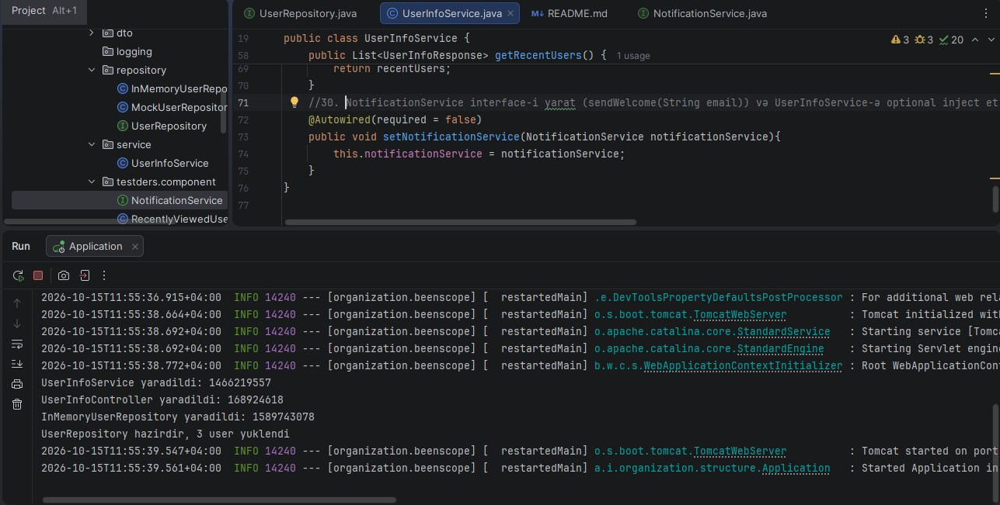

### Tapşırıq 31. ConsoleNotificationService əlavə et, createUser-də Xoş gəldin log-unu gör.@Service
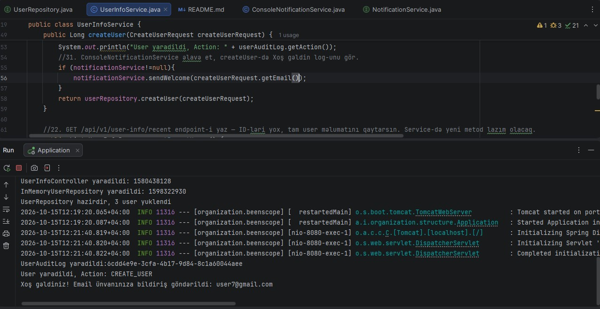

### Tapşırıq 32. UserInfoService üçün Spring-siz unit test yaz. Sonra service-i field injection-a keçir — test niyə işləmir? Şərh yaz və constructor injection-a qaytar.
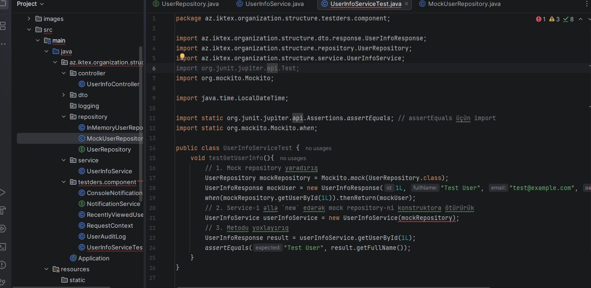

